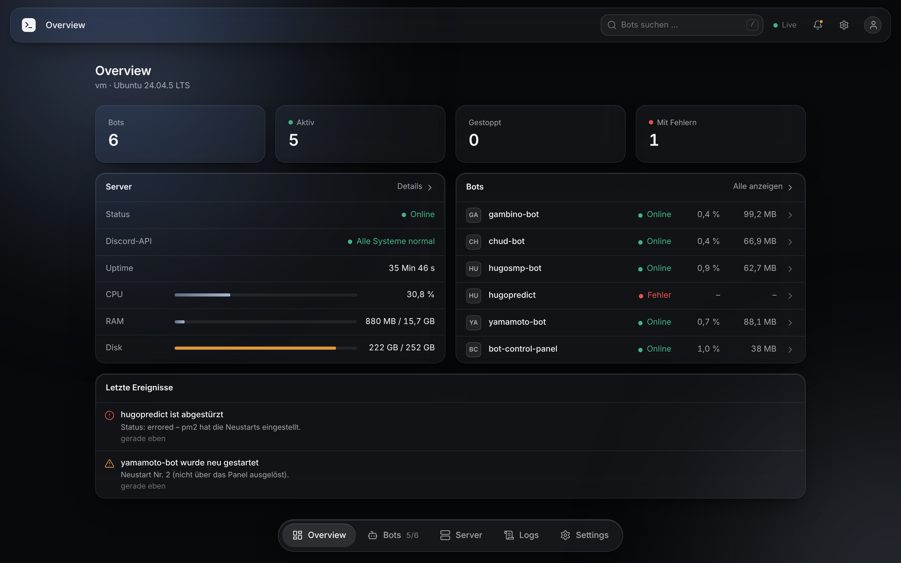
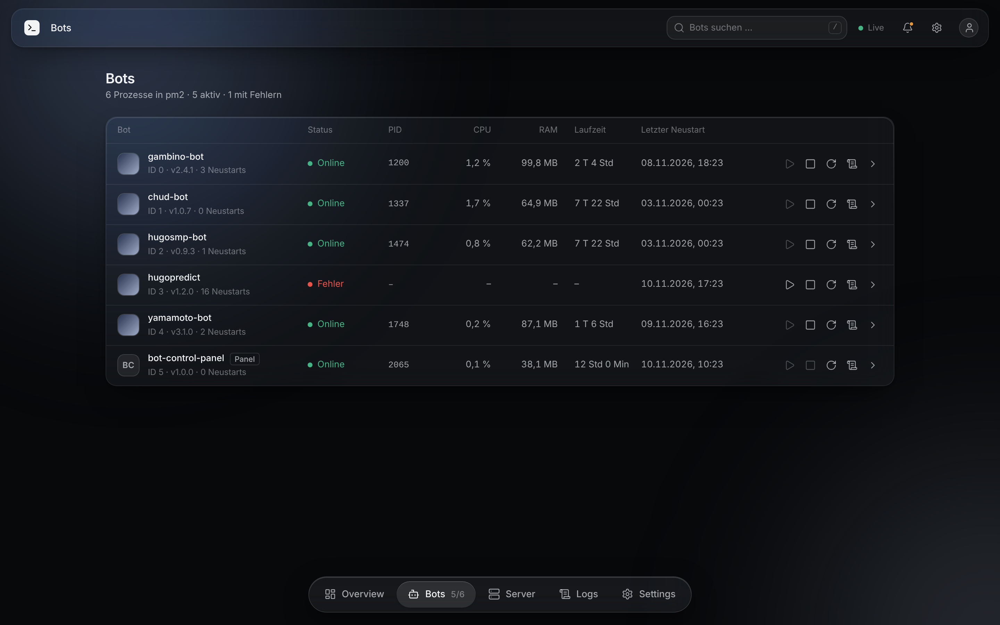
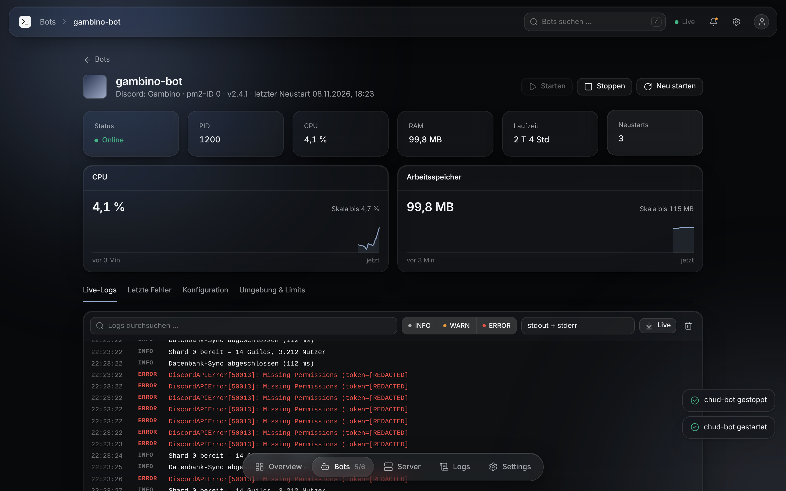
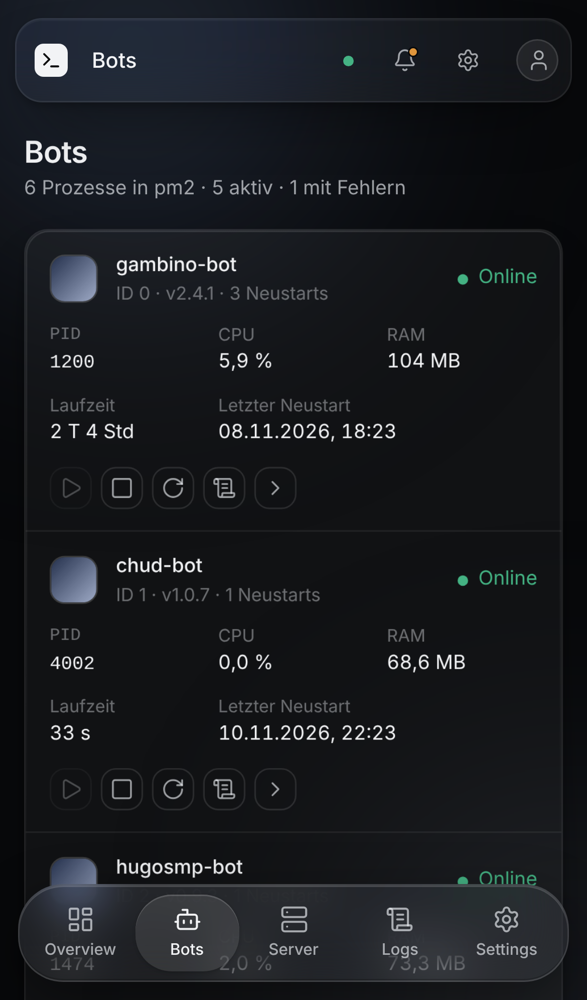

# Bot Control Panel

Schlankes Web-Panel für alle per **pm2** verwalteten Bots auf einem Server: Status, Start/Stop/Restart,
Live-Logs, Server-Metriken. Läuft selbst als pm2-Prozess, ohne Laufzeit-Abhängigkeiten.



| Bots | Bot-Detail | Handy |
| --- | --- | --- |
|  |  |  |

Weitere Screenshots: [`docs/screenshots/`](docs/screenshots).

## Eigenschaften

- **Overview, Bots, Bot-Detail, Server, Logs, Settings** – Dark Mode als Standard, optional hell.
- **Echtzeit** per Server-Sent Events (kein Polling im Browser, kein Seiten-Reload).
- **pm2-Prozesse werden automatisch erkannt** – es wird nichts doppelt gestartet und nichts an
  bestehenden Prozessen oder deren Konfiguration geändert.
- **Wenig RAM:** reines Node.js (`http`/`https`/`crypto`), **0 npm-Pakete zur Laufzeit**. pm2 wird über
  die API des ohnehin global installierten pm2 angesprochen (eine dauerhafte Verbindung zum Daemon).
  Ohne geöffnetes Panel wird nur alle 20 s abgefragt, Logdateien werden gar nicht gelesen.
- **.env-Editor pro Bot:** Variablen hinzufügen, ändern, entfernen – Werte werden nie angezeigt oder an den
  Browser zurückgeschickt, jede Änderung braucht das Panel-Passwort, vorher wird `.env.bak` angelegt.
  Nur für Bots, deren Arbeitsverzeichnis unter dem Home-Ordner liegt (`BCP_ENV_ROOT`), keine Symlinks.
- **RAM-Limit pro Bot:** Liegt ein Bot dreimal hintereinander über dem Limit, startet das Panel ihn neu
  (höchstens alle 5 Min.) und meldet es. Das ist ein Neustart, keine Drosselung – echte Drosselung braucht Container/cgroups.
- **Discord-API-Status** (discordstatus.com, alle 3 Min.) in Overview und Server; Meldung bei Störungen.
- **Discord-Profilbilder:** Das Panel liest das Bot-Token (`DISCORD_TOKEN`, `BOT_TOKEN`, `TOKEN` …) aus der `.env`
  oder pm2-Umgebung, fragt einmal täglich `/users/@me` bei Discord ab und speichert das Bild lokal. Das Token
  bleibt auf dem Server. Abschalten: `BCP_DISCORD_AVATARS=0`. Eigene Bilder in `data/avatars/` haben Vorrang.
- **x64 und arm64:** kein nativer Code, kein Build auf dem Server (`public/` ist eingecheckt).

## Installation

Voraussetzungen: Node ≥ 18.17 (getestet mit 20 und 22), pm2, openssl, git. Alles **als der Benutzer
ausführen, unter dem pm2 läuft** (`ubuntu`), nicht mit `sudo`.

```bash
# 0) Optional vorab: nur lesende Prüfung des Servers
bash scripts/check-server.sh

# 1) Installieren
cd ~ && git clone <REPO-URL> Bot-Control-Panel && cd Bot-Control-Panel
bash install.sh            # Optionen: --port 8443  --ip <öffentliche IP>
```

`install.sh` ist idempotent und

1. prüft Node/pm2/openssl,
2. legt `.env` an (Rechte `600`), fragt Benutzername und Passwort ab (gespeichert wird nur ein scrypt-Hash)
   und erzeugt das Session-Secret,
3. erstellt ein selbst signiertes Zertifikat für die Server-IP (`data/tls/`),
4. startet **nur** den Prozess `bot-control-panel` über pm2 und testet ihn lokal,
5. fragt, ob `pm2 save` ausgeführt werden soll (nötig für den Autostart nach Reboot),
6. zeigt die Firewall-Befehle und den Zertifikats-Fingerabdruck an.

### Port freigeben (Oracle Cloud)

Zwei Stellen müssen den Port (Standard 8443) durchlassen:

**a) iptables auf dem Server** – Oracle-Ubuntu-Images haben eine `REJECT`-Regel in der `INPUT`-Kette;
die neue Regel muss davor stehen:

```bash
sudo iptables -I INPUT "$(sudo iptables -L INPUT --line-numbers -n | awk '/REJECT/{print $1; exit}')" \
  -m state --state NEW -p tcp --dport 8443 -j ACCEPT
sudo netfilter-persistent save      # dauerhaft speichern
sudo iptables -L INPUT -n --line-numbers   # kontrollieren
```

**b) Security List / NSG in der Oracle Cloud Console** – Networking → Virtual Cloud Networks → VCN →
Subnet → Security List → *Add Ingress Rule*: Source CIDR `deine.IP/32` (empfohlen) oder `0.0.0.0/0`,
Protokoll TCP, Destination Port `8443`.

Danach: `https://<Server-IP>:8443`. Der Browser warnt wegen des selbst signierten Zertifikats –
vor dem Akzeptieren den SHA-256-Fingerabdruck mit der Ausgabe von `install.sh` vergleichen
(später auch unter *Settings → Sicherheit* sichtbar).

### Umzug auf einen anderen Server / neue IP

Repo klonen, `bash install.sh` ausführen. Bei gleicher Installation mit neuer IP genügt
`bash install.sh --new-cert --ip <neue IP>`.

## Betrieb

| Aufgabe | Befehl |
| --- | --- |
| Update | `bash update.sh` (holt `git pull --ff-only`, startet nur das Panel neu, prüft die Erreichbarkeit) |
| Automatische Updates | `bash scripts/setup-autoupdate.sh` (Deploy-Key + systemd-Timer, prüft alle 10 s; abschalten mit `--disable`, Log: `journalctl -u bcp-update -n 30`) |
| Passwort ändern | `bash scripts/set-password.sh` |
| 2FA (TOTP) einrichten / entfernen | `bash scripts/setup-2fa.sh` / `bash scripts/setup-2fa.sh --disable` |
| Logs des Panels | `pm2 logs bot-control-panel --lines 50 --nostream` |
| Login-Sperre aufheben | `pm2 restart bot-control-panel` (Sperren liegen nur im Speicher) |
| Deinstallieren | `pm2 delete bot-control-panel && pm2 save`, Ordner löschen, Firewall-Regeln entfernen |

Bot-Bilder (optional): `data/avatars/<pm2-name>.png` (max. 512 KB), z. B. `data/avatars/gambino-bot.png`.

## Sicherheit

- **Login:** scrypt-Hash, zeitkonstanter Vergleich, optional TOTP-2FA mit Schutz gegen Code-Wiederverwendung.
- **Sperre:** 5 Fehlversuche pro IP → 15 Min gesperrt, bei Wiederholung verdoppelt (max. 24 Std);
  zusätzlich globale Bremse (40 Fehlversuche in 15 Min → 5 Min Pause für alle).
- **Session:** zufällige ID, HMAC-signiert, Cookie `__Host-…; HttpOnly; Secure; SameSite=Strict`;
  Ablauf nach 120 Min Inaktivität, spätestens nach 12 Std; ein Neustart des Panels beendet alle Sitzungen.
- **CSRF:** Token pro Session im Header `X-CSRF-Token`, Prüfung von `Origin`/`Sec-Fetch-Site`,
  nur `application/json`.
- **Keine Shell:** Es gibt keinen Endpunkt, der Befehle ausführt. Erlaubt sind ausschließlich
  `start`, `stop`, `restart` auf Prozesse, die in pm2 bereits existieren (ID **und** Name müssen passen).
  Das Panel kann sich selbst nicht stoppen. Jede Aktion wird mit Benutzer und IP protokolliert.
- **Keine Secrets im Browser:** Umgebungsvariablen der Bots werden nur als Namen angezeigt; Logzeilen,
  Argumente und Git-URLs laufen durch einen Filter (Discord-Tokens, Webhooks, JWTs, `Bearer …`,
  `key=value` mit `token/secret/password/…`, Zugangsdaten in URLs). Der Filter ist eine zusätzliche
  Schutzschicht, keine Garantie – Bots sollten Tokens grundsätzlich nicht loggen.
- **Header:** strikte Content-Security-Policy (nur eigene Skripte/Styles, kein Inline), `X-Frame-Options: DENY`,
  `nosniff`, `no-referrer`. TLS ≥ 1.2.
- **Secrets** liegen nur in `.env` (nicht im Repo, Rechte `600`).

Empfehlungen: 2FA aktivieren, in der Security List nur die eigene IP zulassen, langes Passwort verwenden.

## Konfiguration (`.env`)

Siehe [`.env.example`](.env.example). Wichtigste Werte: `BCP_PORT`, `BCP_HOST`, `BCP_ADMIN_USER`,
`BCP_ADMIN_PASSWORD_HASH`, `BCP_SESSION_SECRET`, `BCP_TOTP_SECRET`, `BCP_PM2_MODULE`.

**Alternative: hinter Caddy/nginx statt eigenem TLS** – `BCP_BEHIND_PROXY=1` und `BCP_HOST=127.0.0.1`
setzen; das Panel spricht dann nur lokal HTTP und der Proxy terminiert TLS. Beispiel Caddy
(zusätzlicher Port, internes Zertifikat):

```
https://<Server-IP>:8443 {
    tls internal
    reverse_proxy 127.0.0.1:8444 {
        flush_interval -1
    }
}
```

(dazu `BCP_PORT=8444`). Bei nginx für `/api/stream` und `/api/logs/stream` `proxy_buffering off;` setzen.

## Aufbau

```
server/            Backend (Node, ES-Module, keine Abhängigkeiten)
  index.mjs        Einstieg, HTTPS-Server
  app.mjs          Routen, Auth-Prüfung, SSE, statische Dateien
  auth.mjs         scrypt, TOTP, Sessions, Login-Sperre
  pm2.mjs          pm2-Anbindung (API, Fallback `pm2 jlist`), Whitelist der Aktionen
  monitor.mjs      Abfrage-Schleife, Verlauf, Benachrichtigungen
  system.mjs       CPU/RAM/Disk/Netz aus /proc
  logs.mjs         Lesen/Verfolgen der pm2-Logdateien
  redact.mjs       Maskierung von Secrets
frontend/          Quelltext der Oberfläche (HTML/CSS/ES-Module, ohne Framework)
public/            gebautes Frontend (eingecheckt; wird vom Server ausgeliefert)
scripts/           Prüfskript, Passwort, 2FA, Build
test/              Unit-/Integrationstests und E2E-Lauf mit Chromium
```

## Entwicklung

```bash
npm ci             # nur für den Build: lucide-static (Icons), exakt gepinnt
npm run build      # frontend/ → public/ (+ Icon-Sprite)
npm test           # 20 Tests (node:test), u. a. Auth, CSRF, Whitelist, Maskierung, SSE
npm run e2e        # Chromium (Playwright muss vorhanden sein): Login, Aktionen, Logs, Screenshots
```

Nach Änderungen an `frontend/` immer `npm run build` ausführen und `public/` mit committen.
